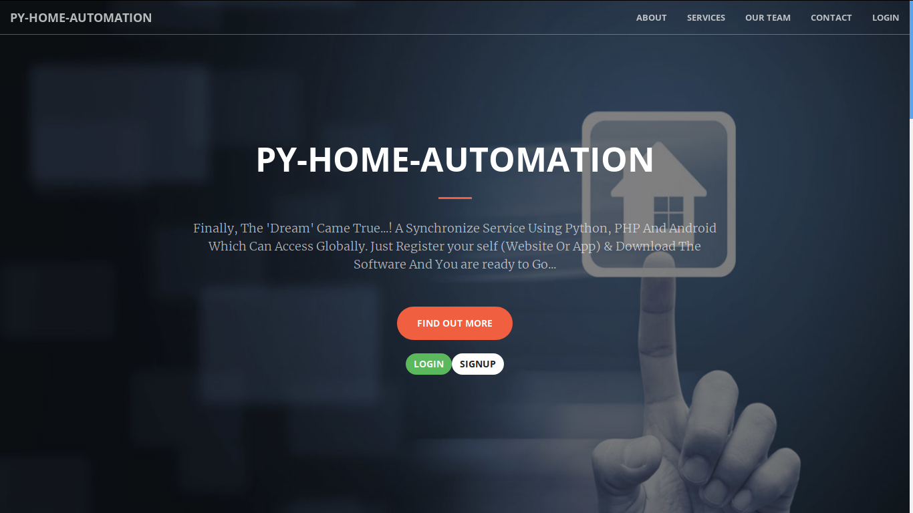

# Py-Home-Automation 🏠

> A Raspberry Pi-based home automation system with voice control, face detection security, and remote device management via Android app, PHP web dashboard, and Python IoT client.



---

## Table of Contents

- [Overview](#overview)
- [Architecture](#architecture)
- [Components](#components)
  - [Pi-Client (Python)](#pi-client-python)
  - [PHP-Webserver](#php-webserver)
  - [Android-App](#android-app)
- [Database Schema](#database-schema)
- [API Reference](#api-reference)
- [Setup & Installation](#setup--installation)
- [Configuration](#configuration)
- [How It Works](#how-it-works)
- [Project Structure](#project-structure)
- [Dependencies](#dependencies)
- [Contributing](#contributing)
- [License](#license)

---

## Overview

Py-Home-Automation is a full-stack IoT home automation platform that enables users to control electrical devices (lights, fans, appliances) connected to a Raspberry Pi's GPIO pins. The system supports:

- **Voice Commands** — Send spoken commands via the Android app (speech-to-text).
- **Remote Control** — Control devices from anywhere via the PHP web server relay (local or global network).
- **Face Detection Security** — A built-in security camera system using OpenCV that detects faces, emails snapshots, and uploads images to the web dashboard.
- **Device Registration** — Raspberry Pi devices auto-register with the server using MAC address, IP, and geolocation.
- **Multi-User** — Users register/login via the web portal or Android app; admins approve Pi devices.

---

## Architecture

```
┌──────────────┐         ┌──────────────────┐         ┌──────────────┐
│  Android App │ ──────▶ │  PHP Web Server  │ ──────▶ │  Pi-Client   │
│  (Voice/UI)  │  HTTP   │  (MySQL + API)   │  TCP    │  (Python)    │
│              │ ◀────── │                  │  Socket │              │
└──────────────┘         └──────────────────┘         └──────┬───────┘
                                  ▲                          │
                                  │ HTTP                     │ GPIO
                                  │                          ▼
                         ┌────────┴───────┐          ┌──────────────┐
                         │   Web Browser  │          │  Electrical  │
                         │   (Dashboard)  │          │   Devices    │
                         └────────────────┘          └──────────────┘
```

### Communication Flow

1. **Android → PHP Server** — User speaks a command; Android sends it via HTTP POST to the PHP API.
2. **PHP Server → Pi-Client** — The server looks up the user's registered Pi device IP and forwards the command via raw TCP socket (port `1997`).
3. **Pi-Client → GPIO** — The Python socket server receives the command, maps it to a device number, and toggles the appropriate GPIO pin.
4. **Pi-Client → PHP Server** — The face recognizer captures images and uploads them to the web server via HTTP POST.
5. **Pi-Client → Email** — Face detection snapshots are also emailed to the device owner via Gmail SMTP.

---

## Components

### Pi-Client (Python)

The Python client runs on a Raspberry Pi and is the core IoT controller.

| Module | File | Purpose |
|--------|------|---------|
| **Entry Point** | `run.py` | Authenticates with the server, registers the device, then starts the socket server and face recognizer in parallel threads. |
| **Socket Server** | `PyHome/server/server.py` | TCP socket server (port `1997`) that listens for incoming commands and dispatches them to GPIO control. |
| **GPIO Control** | `PyHome/gpio_pins/gpio_pins.py` | Maps device numbers (1–4) to GPIO pin states. Uses `RPi.GPIO` on real hardware. |
| **Face Recognizer** | `PyHome/face_recognizer/face_recognizer.py` | OpenCV-based face detection supporting webcam and mobile (IP Webcam) streams. Triggers email + web upload on detection. |
| **Network Utils** | `PyHome/functions/functions.py` | Retrieves MAC address, local/global IP, and geolocation via GeoLite database. |
| **Settings Reader** | `PyHome/settings_reader/settings_reader.py` | Reads `settings/config.json` for runtime configuration. |
| **Command Reader** | `PyHome/command_reader/command_reader.py` | Reads `settings/commands.json` for custom voice command mappings. |
| **Email Notifier** | `PyHome/email/mail.py` | Sends security camera snapshots as email attachments via Gmail SMTP. |
| **Web Uploader** | `PyHome/web_uploader/web_uploader.py` | Uploads security camera images to the PHP web server. |
| **URL Config** | `PyHome/urls/urls.py` | Centralized API endpoint URLs. |
| **First Run Setup** | `PyHome/first_run/first_run.py` | Interactive CLI wizard for initial configuration (creates `settings/config.json` and `settings/commands.json`). |

### PHP-Webserver

A LAMP-stack web application providing user management, device registration, a security camera gallery, and the command relay between Android and Pi.

| File | Purpose |
|------|---------|
| `index.php` | Main entry point with Bootstrap-based SPA routing (`?page=...`). |
| `api/login.php` | User authentication (POST: email, password → JSON response). |
| `api/register.php` | User registration (POST: name, email, password). |
| `api/reg_pi.php` | Raspberry Pi device registration (POST: mac, local_ip, global_ip, email, lat, lng). |
| `api/Android_Pi.php` | **Command relay** — Receives commands from Android, looks up the Pi's IP, and forwards via TCP socket. |
| `api/Pi_web_img.php` | Security camera image upload endpoint. |
| `api/get.php` | GET-based login (for testing). |
| `api/include/DB_Functions.php` | Database abstraction layer (user CRUD, device CRUD, password hashing, socket forwarding). |
| `db/pyhomeautomation.sql` | MySQL schema with tables: `users`, `devices`, `commands`, `history`, `security_cam`, `feedback`, `payments`. |

### Android-App

A native Android (Java) app with voice recognition for hands-free device control.

| Class | Purpose |
|-------|---------|
| `MainActivity` | Main screen with voice input, radio buttons for host type (local/global/direct), and command dispatch. |
| `LoginActivity` | User login screen. |
| `RegisterActivity` | User registration screen. |
| `LogoutActivity` | Session cleanup and logout. |
| `SendMessage` | `AsyncTask` that sends raw TCP socket messages directly to the Pi (local mode). |
| `AppConfig` | Centralized server URL configuration. |
| `AppController` | Volley request queue singleton. |
| `SQLiteHandler` | Local SQLite database for caching user session data. |
| `SessionManager` | SharedPreferences-based login state management. |

---

## Database Schema

```
┌─────────────────┐     ┌──────────────────┐     ┌────────────────┐
│     users        │     │     devices       │     │   commands     │
├─────────────────┤     ├──────────────────┤     ├────────────────┤
│ id (PK)          │     │ no. (PK)          │     │ id (PK)        │
│ unique_id (UQ)   │◀───│ owner (email FK)  │───▶│ owner (email)  │
│ fname            │     │ device_unique_id  │     │ number_of_device│
│ lname            │     │ mac               │     │ oncommand      │
│ email (UQ)       │     │ local_ip          │     │ offcommand     │
│ encrypted_password│    │ global_ip         │     └────────────────┘
│ salt             │     │ latitude          │
│ mobile_no        │     │ longitude         │     ┌────────────────┐
│ dob              │     │ created_at        │     │  security_cam  │
│ user_type        │     │ updated_at        │     ├────────────────┤
│ profile_pic      │     │ status (0/1)      │     │ id (PK)        │
│ city             │     └──────────────────┘     │ owner (email)  │
│ country          │                                │ img_path       │
│ gender           │     ┌──────────────────┐     │ created_at_date│
│ address          │     │     history       │     │ created_at_time│
│ created_at       │     ├──────────────────┤     └────────────────┘
│ updated_at       │     │ id (PK)          │
└─────────────────┘     │ owner (email)    │     ┌────────────────┐
                         │ message          │     │   feedback     │
                         │ time             │     ├────────────────┤
                         │ host_type        │     │ no (PK)        │
                         │ status (0/1)     │     │ name, email    │
                         └──────────────────┘     │ user_type      │
                                                   │ date, feedback │
                                                   └────────────────┘
```

---

## API Reference

### `POST /api/login.php`

Authenticate a user.

| Parameter | Type | Required | Description |
|-----------|------|----------|-------------|
| `email` | string | ✅ | User's email address |
| `password` | string | ✅ | User's password |

**Response (success):**
```json
{
  "error": false,
  "uid": "unique_id",
  "user": { "name": "...", "email": "...", "created_at": "...", "updated_at": "..." }
}
```

### `POST /api/register.php`

Register a new user.

| Parameter | Type | Required |
|-----------|------|----------|
| `name` | string | ✅ |
| `email` | string | ✅ |
| `password` | string | ✅ |

### `POST /api/reg_pi.php`

Register a Raspberry Pi device.

| Parameter | Type | Required | Description |
|-----------|------|----------|-------------|
| `mac` | string | ✅ | Device MAC address |
| `local_ip` | string | ✅ | LAN IP address |
| `global_ip` | string | ✅ | Public IP address |
| `email` | string | ✅ | Owner's email |
| `latitude` | string | ✅ | Device latitude |
| `longitude` | string | ✅ | Device longitude |

### `POST /api/Android_Pi.php`

Relay a command from Android to the Pi. The server resolves the Pi's IP from the database and forwards the command via TCP socket on port `1997`.

| Parameter | Type | Required | Description |
|-----------|------|----------|-------------|
| `email` | string | ✅ | User's email |
| `msg` | string | ✅ | The command text (e.g., "turn on fan") |
| `host` | string | ✅ | `"local"` or `"global"` |

### `POST /api/Pi_web_img.php`

Upload a security camera image.

| Parameter | Type | Required | Description |
|-----------|------|----------|-------------|
| `email` | string | ✅ | Owner's email |
| `image` | file | ✅ | JPEG/PNG image (max 2MB) |

---

## Setup & Installation

### Prerequisites

- **Raspberry Pi** (any model with GPIO) running Raspbian/Raspberry Pi OS
- **Python 2.7** (current codebase — Python 3 migration recommended)
- **LAMP Stack** (Linux, Apache, MySQL/MariaDB, PHP 7+) on a server
- **Android Studio** for building the Android app

### 1. Database Setup

```bash
# Import the database schema
mysql -u root -p < PHP-Webserver/db/pyhomeautomation.sql
```

### 2. PHP Web Server

1. Copy `PHP-Webserver/` contents to your web server document root (e.g., `/var/www/html/PyHomeAutomation/`).
2. Update database credentials in `PHP-Webserver/api/include/Config.php`.
3. Create a `Security_images/` directory alongside the webserver root with write permissions.

### 3. Pi-Client Setup

```bash
cd Pi-Client/

# Install Python dependencies
pip install requests netifaces pif pygeoip opencv-python numpy

# For Raspberry Pi GPIO (on actual Pi hardware)
pip install RPi.GPIO

# Run the client (first run triggers interactive setup wizard)
python run.py
```

### 4. Android App

1. Open `Android-App/` in Android Studio.
2. Update server URLs in `app/src/main/java/com/vasu/venom/afinal/app/AppConfig.java`.
3. Build and install on your Android device.

---

## Configuration

### Pi-Client: `settings/config.json`

Created automatically on first run. Example:

```json
{
    "interface_name": "wlan0",
    "email": "user@example.com",
    "password": "your_password",
    "device": 0,
    "webcam_no": 0,
    "mobile_mode": 0,
    "email_update_interval": 60,
    "email_folder_name": "draft",
    "web_folder_name": "sent"
}
```

| Key | Description |
|-----|-------------|
| `interface_name` | Network interface name (e.g., `wlan0`, `eth0`) |
| `email` | Account email registered on the web server |
| `password` | Account password |
| `device` | Camera source: `0` = Webcam, `1` = Mobile (IP Webcam) |
| `webcam_no` | Webcam index (default `0` for built-in) |
| `mobile_mode` | `0` = IP Webcam app (default URL), `1` = manual URL entry |
| `email_update_interval` | Minimum seconds between email notifications |
| `email_folder_name` | Local folder for email-bound snapshots |
| `web_folder_name` | Local folder for web-upload-bound snapshots |

### Pi-Client: `settings/commands.json`

Maps voice commands to device actions. Example:

```json
{
    "device_1_on": "turn on light",
    "device_1_off": "turn off light",
    "device_2_on": "turn on fan",
    "device_2_off": "turn off fan",
    "device_3_on": "turn on tv",
    "device_3_off": "turn off tv",
    "device_4_on": "turn on ac",
    "device_4_off": "turn off ac"
}
```

### URL Configuration: `PyHome/urls/urls.py`

Update these URLs to point to your PHP web server:

```python
URL_REG = 'http://YOUR_SERVER_IP/PyHomeAutomation/api/reg_pi.php?'
URL_LOGIN = 'http://YOUR_SERVER_IP/PyHomeAutomation/api/login.php?'
URL_IMG = 'http://YOUR_SERVER_IP/PyHomeAutomation/api/Pi_web_img.php?'
```

---

## How It Works

### Startup Flow

```
run.py starts
    │
    ├── Config files exist?
    │       │
    │       NO → first_run.py (interactive setup wizard)
    │       │
    │       YES ↓
    │
    ├── Read settings/config.json
    ├── POST /api/login.php (authenticate user)
    ├── Get network info (MAC, local IP, global IP, geolocation)
    ├── POST /api/reg_pi.php (register/update device)
    │
    ├── Device approved (status=1)?
    │       │
    │       NO → Exit with message
    │       │
    │       YES ↓
    │
    ├── Thread 1: Start TCP Socket Server (port 1997)
    │       └── Listen for commands → dispatch to GPIO
    │
    └── Thread 2: Start Face Recognizer
            └── Capture frames → detect faces → email + upload snapshots
```

### Command Flow (Voice Control)

```
User speaks "turn on light"
    │
    ├── Android captures speech → text
    │
    ├── Mode: Local Direct
    │       └── TCP socket → Pi:1997 → "turn on light" → commands.json lookup → GPIO
    │
    ├── Mode: Local (via server)
    │       └── HTTP POST → PHP server → DB lookup (command → device #) → TCP → Pi:1997
    │
    └── Mode: Global (via server)
            └── HTTP POST → PHP server → DB lookup → TCP (global IP) → Pi:1997
```

---

## Project Structure

```
Py-Home-Automation/
├── README.md                          # This file
├── main-screen.png                    # Web dashboard screenshot
│
├── Pi-Client/                         # 🐍 Python Raspberry Pi client
│   ├── run.py                         # Entry point
│   ├── PyHome/                        # Main package
│   │   ├── __init__.py
│   │   ├── command_reader/            # Voice command JSON reader
│   │   ├── email/                     # Gmail SMTP email sender
│   │   ├── face_recognizer/           # OpenCV face detection
│   │   ├── first_run/                 # First-run setup wizard
│   │   ├── functions/                 # Network utility functions
│   │   ├── gpio_pins/                 # Raspberry Pi GPIO control
│   │   ├── server/                    # TCP socket server
│   │   ├── settings_reader/           # Config JSON reader
│   │   ├── urls/                      # API endpoint URLs
│   │   └── web_uploader/             # Image upload to web server
│   ├── models/                        # OpenCV Haar cascade XML models
│   │   ├── haarcascade_frontalface_default.xml
│   │   ├── haarcascade_eye.xml
│   │   ├── haarcascade_eye_tree_eyeglasses.xml
│   │   └── haarcascade_smile.xml
│   └── geo_lite/                      # MaxMind GeoLite IP geolocation DB
│       └── GeoLiteCity.dat
│
├── PHP-Webserver/                     # 🌐 PHP web application
│   ├── index.php                      # Main entry (Bootstrap SPA)
│   ├── api/                           # REST API endpoints
│   │   ├── login.php                  # User authentication
│   │   ├── register.php               # User registration
│   │   ├── reg_pi.php                 # Pi device registration
│   │   ├── Android_Pi.php             # Android → Pi command relay
│   │   ├── Pi_Android.php             # Pi → Android (stub)
│   │   ├── Pi_web_img.php             # Security image upload
│   │   ├── get.php                    # GET-based login (test)
│   │   └── include/
│   │       ├── DB_Functions.php       # Database abstraction layer
│   │       ├── DB_Connect.php         # MySQL connection
│   │       └── Config.php             # DB credentials
│   ├── db/
│   │   └── pyhomeautomation.sql       # Database schema
│   ├── pages/                         # Web UI pages
│   │   ├── login.php, signup.php      # Auth pages
│   │   ├── user.php, admin.php        # User/Admin dashboards
│   │   ├── services.php               # Device control UI
│   │   ├── gallery.php                # Security camera gallery
│   │   └── core/                      # Layout partials
│   ├── css/, js/, fonts/, img/        # Static assets
│   └── vendor/                        # Bootstrap, jQuery, etc.
│
└── Android-App/                       # 📱 Android application
    └── app/src/main/java/com/vasu/venom/afinal/
        ├── activity/
        │   ├── MainActivity.java      # Voice control + command dispatch
        │   ├── LoginActivity.java     # Login screen
        │   ├── RegisterActivity.java  # Registration screen
        │   └── LogoutActivity.java    # Logout handler
        ├── app/
        │   ├── AppConfig.java         # Server URL configuration
        │   └── AppController.java     # Volley request queue
        └── helper/
            ├── SendMessage.java       # Direct TCP socket messenger
            ├── SQLiteHandler.java     # Local user data cache
            └── SessionManager.java    # Login session management
```

---

## Dependencies

### Pi-Client (Python)

| Package | Purpose |
|---------|---------|
| `requests` | HTTP client for API calls |
| `netifaces` | Network interface info (MAC, IP) |
| `pif` | Public IP address detection |
| `pygeoip` | IP-to-geolocation (GeoLite) |
| `opencv-python` | Face detection and camera capture |
| `numpy` | Image array processing |
| `RPi.GPIO` | Raspberry Pi GPIO pin control |

### PHP-Webserver

| Dependency | Version |
|------------|---------|
| PHP | 7.1+ |
| MySQL/MariaDB | 10.1+ |
| Apache | 2.4+ |

### Android-App

| Library | Purpose |
|---------|---------|
| Volley | HTTP networking |
| Android Support Libraries | AppCompat, etc. |

---

## Known Limitations & Notes

> ⚠️ **Python 2 Codebase** — The Pi-Client currently uses Python 2 syntax (`print` statements, `raw_input()`, `urllib.urlopen()`). A Python 3 migration is recommended.

> ⚠️ **Hardcoded Credentials** — Email credentials in `mail.py` and server IPs in various config files need to be updated for your environment.

> ⚠️ **Security** — The TCP socket protocol has no authentication or encryption. The PHP API uses custom password hashing rather than `password_hash()`/`password_verify()`. The `fatch_host()` and `fatch_user_commands()` functions in `DB_Functions.php` are vulnerable to SQL injection.

> ⚠️ **GPIO Stub** — The GPIO module (`gpio_pins.py`) currently only prints messages. Uncomment the `RPi.GPIO` import and add actual pin control logic for real hardware.

---

## Contributing

1. Fork the repository
2. Create a feature branch (`git checkout -b feature/my-feature`)
3. Commit your changes (`git commit -am 'Add my feature'`)
4. Push to the branch (`git push origin feature/my-feature`)
5. Open a Pull Request

---

## License

This project is open source. See the repository for license details.

---

*Developed by [Vasu Ratanpara](http://vasuratanpara.github.io)*
