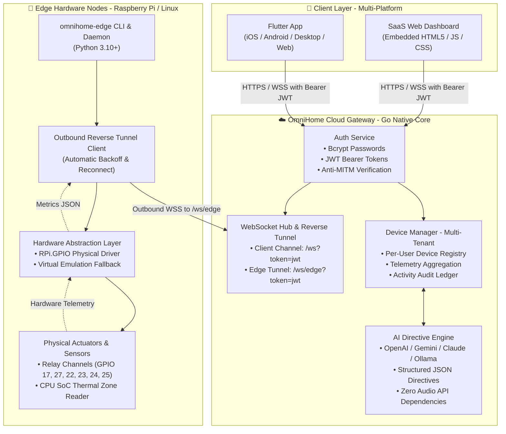
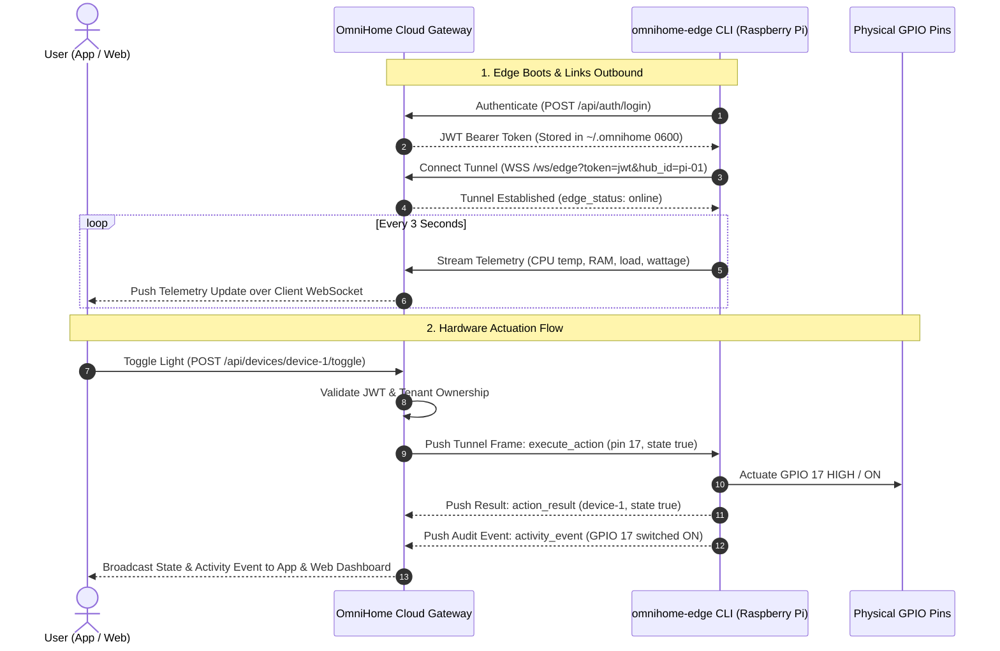

# OmniHome 🏠⚡
### Multi-Tenant Cloud Architecture, Edge Reverse Tunneling & Multi-Platform Client

[](LICENSE)
[](#-cloud-backend-architecture)
[](#-edge-device-cli-omnihome-edge)
[](#-multi-platform-flutter-app)
[](#-security--multi-tenancy)


> **OmniHome** is an enterprise-grade smart home and edge automation platform designed around a secure cloud hub, zero-inbound-port edge reverse tunneling, and strict multi-tenancy. Hardware actuation is bridged from any browser or mobile device down to edge hardware (Raspberry Pi 3/4/5 or Linux nodes) in real time.

---

## 📑 Table of Contents

- [Key Architectural Highlights](#-key-architectural-highlights)
- [System Architecture Diagram](#-system-architecture-diagram)
- [Edge Reverse Tunneling & Command Flow](#-edge-reverse-tunneling--command-flow)
- [Security & Multi-Tenancy](#-security--multi-tenancy)
- [Cloud Backend (`server/`)](#-cloud-backend-server)
- [Edge Device CLI (`edge/`)](#-edge-device-cli-edge)
- [Multi-Platform Flutter App (`app/`)](#-multi-platform-flutter-app-app)
- [Embedded Web Dashboard (`server/web/`)](#-embedded-web-dashboard-serverweb)
- [Configurable AI Directive Engine](#-configurable-ai-directive-engine)
- [Repository Structure](#-repository-structure)
- [Quick Start Guide](#-quick-start-guide)

---

## 🌟 Key Architectural Highlights

1. **Strict Multi-Tenancy & User Isolation:**
   - Every tenant's devices, automation presets, activities, and telemetry streams are partitioned strictly by `UserID`.
   - Cross-tenant device access is cryptographically blocked via stateless HMAC-SHA256 JWT tokens and bcrypt password hashing (`cost 12`).
2. **NAT Traversal via Outbound Reverse Tunneling (`/ws/edge`):**
   - Edge hardware (Raspberry Pi behind home NAT/firewalls) opens an **outbound persistent WebSocket connection** to the Cloud.
   - No dynamic DNS, port forwarding, or public IP needed on the home edge network.
3. **Hardware Actuation & Telemetry Streaming:**
   - Commands initiated in the Flutter App or Web Dashboard flow to the Cloud, which routes `execute_action` frames down the active Edge WebSocket tunnel.
   - The Edge CLI physically actuates Raspberry Pi GPIO pins (or virtual mock pins on development machines) and continuously streams hardware telemetry (CPU temp, load, RAM, wattage) back to the cloud.
4. **Zero Broken TTS/STT Dependencies:**
   - Cloud AI processing operates purely on structured text/JSON synthesis (compatible with OpenAI, Gemini, Claude, Ollama, or local heuristics).
   - Audio recognition and voice synthesis are handled client-side via native OS speech engines or browser Web Speech APIs.

---

## 🏛️ System Architecture Diagram



---

## 🔄 Edge Reverse Tunneling & Command Flow

Edge devices typically cannot receive direct inbound connections from a cloud server due to NAT firewalls. OmniHome solves this using persistent outbound reverse tunneling:



---

## 🔒 Security & Multi-Tenancy

- **Cryptographic User Isolation:** Every entity (Device, Telemetry, Scene, Activity Item, Camera Snapshot) includes a mandatory `UserID`. In-memory and persistent registries guarantee that User A cannot read, toggle, or affect User B's hardware.
- **Reverse Tunnel Verification:** Inbound `/ws/edge` connections require valid tenant JWT bearer tokens. Actuation signals are routed strictly down the tunnel matching the authenticated `claims.UserID`.
- **Anti-Tampering File Permissions:** Stored edge credentials in `~/.omnihome/edge_config.json` are written with strict `0600` permissions (owner read/write only) inside a `0700` directory.
- **MITM Resistance:** All HTTP and WebSocket endpoints validate standard Authorization headers (`Authorization: Bearer <token>`).

---

## ☁️ Cloud Backend (`server/`)

Written in idiomatic Go 1.22+ for high throughput and minimal memory consumption (<25 MB RAM):

- **Main Router (`server/main.go`):** HTTP REST APIs, `/ws` client socket, and `/ws/edge` hardware reverse tunnel.
- **Auth Service (`server/internal/auth/`):** Passwords hashed with bcrypt (`cost 12`), HMAC-SHA256 JWT tokens with 30-day expiry.
- **Device Manager (`server/internal/service/`):** Multi-tenant state manager, concurrent RWMutex locking, and optimistic actuation synchronization.
- **AI Service (`server/internal/ai/`):** Multi-provider natural language directive synthesis (OpenAI, Gemini, Claude, Ollama, custom HTTP endpoint, local heuristics).
- **Embedded Web Assets (`server/web/`):** HTML5, CSS3, and JavaScript dashboard embedded directly into the Go executable via `go:embed`.

---

## 🔌 Edge Device CLI (`edge/`)

The edge CLI daemon runs on Raspberry Pi 3/4/5 or Linux edge devices:

```bash
# Direct launcher
./bin/omnihome-edge <command>

# Or via Python module
python3 -m edge.cli <command>
```

### Supported CLI Commands

| Command | Description |
| :--- | :--- |
| `omnihome-edge login` | Authenticates edge with Cloud credentials and saves token to `~/.omnihome/edge_config.json` (`0600`). |
| `omnihome-edge logout` | Wipes saved credentials and clears local token. |
| `omnihome-edge status` | Inspects local GPIO driver, CPU SoC temperature, RAM, load, and pings the Cloud Gateway. |
| `omnihome-edge start` | Launches persistent reverse WebSocket tunnel to `/ws/edge`, streams telemetry, and listens for actuation. |
| `omnihome-edge devices` | Lists the tenant's registered devices and GPIO pin assignments from the cloud. |
| `omnihome-edge pin-test` | Directly toggles a physical GPIO pin for hardware diagnostics (`omnihome-edge pin-test 17 on`). |

---

## 📱 Multi-Platform Flutter App (`app/`)

Cross-platform client for iOS, Android, Linux desktop, macOS, Windows, and Web:

- **Authentication Flow (`app/lib/screens/login_screen.dart`):** Multi-tenant sign in and registration with configurable cloud gateway URLs.
- **Real-Time Gateway Service (`app/lib/services/gateway_service.dart`):** Authenticated REST requests, tokenized WebSocket (`/ws?token=<jwt>`), and edge online/offline callbacks.
- **Reactive State (`app/lib/providers/home_provider.dart`):** Live telemetry metrics, optimistic device toggles, automation scenes, and audit activity ledger.
- **Hardware & Hub Status (`app/lib/screens/settings_screen.dart`):** Shows authenticated tenant profile, active cloud URL, and a live Edge Reverse Tunnel link indicator (`🟢 Connected` / `🔴 Offline`).

---

## 🌐 Embedded Web Dashboard (`server/web/`)

- Modern dark theme with real-time responsive cards and live telemetry charts.
- Modal-based tenant login and registration.
- Header status pill showing Cloud ping latency and Edge Reverse Tunnel connectivity.
- Natural language spotlight prompt for text-based assistant directives.

---

## 🧠 Configurable AI Directive Engine

The Cloud AI Engine translates natural language requests (e.g. *"turn off living room light and lock front door"*) into structured actuation directives:

- **Supported Providers:**
  - `openai`: GPT-4o / GPT-4o-mini
  - `gemini`: Google Gemini 1.5 Pro / Flash
  - `anthropic`: Claude 3.5 Sonnet / Haiku
  - `ollama`: Self-hosted local LLMs (e.g., Llama 3, Mistral)
  - `custom`: Custom HTTP JSON endpoint
  - `local`: High-speed zero-dependency built-in NLP heuristics
- **Audio Independence:**
  - Operates purely on text prompts and JSON outputs.
  - Client devices utilize client-side speech recognition and synthesis (`window.speechSynthesis` in browser, native speech on mobile/desktop), avoiding broken external audio APIs.

---

## 📂 Repository Structure

```
Py-Home-Automation/
├── app/                        # 📱 Flutter cross-platform client (Mobile & Desktop)
│   ├── lib/
│   │   ├── models/             # Device, Telemetry, Scene, AuthUser models
│   │   ├── providers/          # HomeProvider reactive state
│   │   ├── screens/            # Dashboard, Devices, Cameras, Activity, Settings, Login
│   │   ├── services/           # GatewayService (Authenticated REST & WebSocket)
│   │   └── theme/              # AppTheme design tokens
│   └── test/                   # Flutter widget & unit tests
│
├── bin/
│   └── omnihome-edge           # ⚡ Edge CLI launcher script
│
├── edge/                       # 🔌 Python 3 Edge device CLI & hardware daemon
│   ├── cli.py                  # CLI command implementation (login, status, start, etc.)
│   ├── client.py               # Authenticated WebSocket reverse tunnel client
│   ├── config.py               # Credentials manager (0600 file permissions)
│   ├── hardware.py             # GPIO HAL (RPi.GPIO + Virtual emulation fallback)
│   └── requirements.txt        # Edge dependencies (websockets, requests, psutil)
│
├── server/                     # ☁️ Go multi-tenant cloud backend
│   ├── main.go                 # HTTP/WebSocket gateway entry point
│   ├── internal/
│   │   ├── ai/                 # Configurable AI directive processing
│   │   ├── auth/               # Bcrypt password hashing & JWT token service
│   │   ├── hub/                # Multi-tenant WebSocket client & edge tunnel hub
│   │   ├── model/              # Domain models (Device, User, HubNode, Settings)
│   │   └── service/            # DeviceManager with strict tenant isolation
│   └── web/                    # Embedded SaaS Web Dashboard (HTML/CSS/JS)
│
└── README.md                   # 📖 Platform architecture & documentation
```

---

## 🚀 Quick Start Guide

### 1. Build & Start the Cloud Backend

```bash
cd server
go build -o omnihome main.go
./omnihome
# Cloud Dashboard: http://localhost:8080
```

### 2. Connect the Edge Device CLI (Raspberry Pi or Linux)

```bash
# 1. Authenticate with the Cloud Gateway
./bin/omnihome-edge login --cloud http://localhost:8080

# 2. Check local hardware and cloud link
./bin/omnihome-edge status

# 3. Start the reverse tunnel & telemetry daemon
./bin/omnihome-edge start
```

### 3. Run the Flutter App

```bash
cd app
flutter run -d linux   # Run native desktop app (or -d chrome for web)
```

---

<p align="center">
  <b>OmniHome — Modern, Secure, Cloud-Connected Home Automation</b>
</p>
