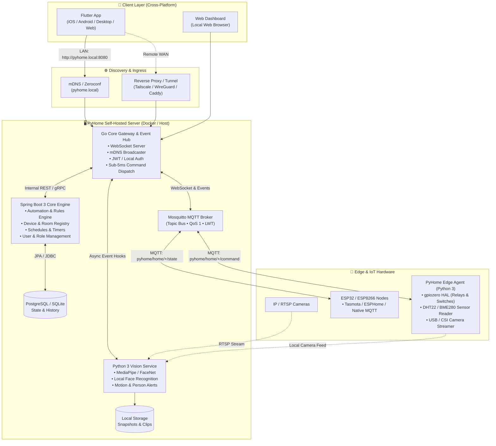
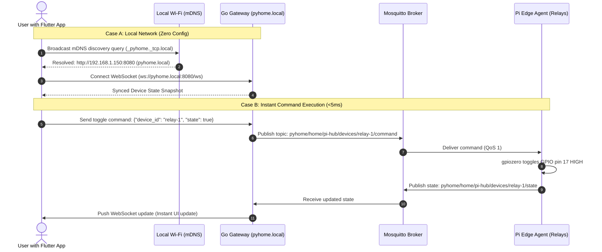
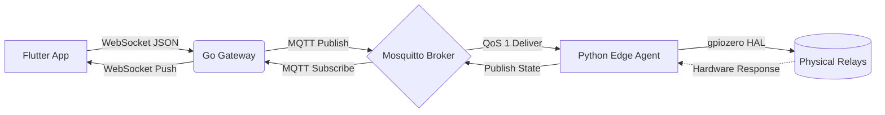

# PyHome 🏠⚡
### Modern, Local-First, Open-Source Smart Home Platform

[](LICENSE)
[](#architecture)
[](#mqtt-message-flow)
[](#technology-stack)
[](#technology-stack)
[](#technology-stack)
[](#technology-stack)


> **PyHome** is an open-source, privacy-first home automation and edge-security ecosystem. Designed for self-hosting with zero required external cloud dependencies, offline-first reliability, and real-time device control across mobile, desktop, and web.

---

## 📑 Table of Contents

- [Key Pillars](#-key-pillars)
- [System Architecture Diagram](#-system-architecture-diagram)
- [Network & Discovery Flow](#-network--discovery-flow)
- [MQTT Message & Control Flow](#-mqtt-message--control-flow)
- [Technology Stack](#-technology-stack)
- [Edge Client Modernization (Python 3)](#-edge-client-modernization-python-3)
- [Self-Hosted Deployment](#-self-hosted-deployment)
- [Monorepo Structure](#-monorepo-structure)
- [Roadmap](#-roadmap)
- [Legacy Reference](#-legacy-reference)

---

## 🌟 Key Pillars

1. **Local-First & Offline Resilient:** If your internet goes down, your house keeps working. All device states, automations, and camera processing run directly on your local network.
2. **Zero Cloud Lock-in:** No mandatory subscriptions, no required AWS/Firebase dependencies. Open push notification support via [ntfy.sh](https://ntfy.sh) / [Gotify](https://gotify.net).
3. **Hardware Agnostic:** Controls Raspberry Pi GPIO relays, ESP32/ESP8266 boards, smart plugs, sensors, and RTSP/USB cameras.
4. **Lightweight Self-Hosting:** Runs seamlessly on a single Raspberry Pi 4/5, Intel NUC, or home NAS with a combined memory footprint under 1 GB RAM.

---

## 🏛️ System Architecture Diagram



---

## 🌐 Network & Discovery Flow

PyHome prioritizes zero-configuration on your home network while providing secure remote access without risky port forwarding.



---

## 📡 MQTT Message & Control Flow

Device communication uses a standardized MQTT 5.0 topic namespace:

```
pyhome/
└── {environment}/                     # e.g., "home"
    └── {hub_id}/                       # e.g., "pi-living-room"
        ├── status                      # Retained: {"status": "online"|"offline"} (LWT)
        ├── telemetry                   # {"cpu_temp": 42.1, "ram_used": 34.2, "uptime": 10240}
        ├── devices/
        │   └── {device_id}/
        │       ├── command             # Inbound:  {"command_id": "...", "state": true}
        │       └── state               # Outbound: {"device_id": "...", "state": true}
        └── events/
            └── vision                  # Alert:    {"type": "face_detected", "confidence": 0.96}
```



---

## 💻 Technology Stack

| Layer | Component | Language / Framework | Key Responsibility |
| :--- | :--- | :--- | :--- |
| **Frontend** | Cross-Platform App | **Flutter 3** (Dart) | Single UI code for iOS, Android, Linux, macOS, Windows & Web. |
| **Edge Gateway** | Real-time Hub | **Go 1.23+** | mDNS discovery, WebSocket server, MQTT bridge (<25 MB RAM). |
| **Core Service** | Automations & Registry | **Spring Boot 3** (Java 21) | Device registry, complex rules engine, schedules, and RBAC. |
| **Edge Agent** | Pi IoT Client | **Python 3.12+** | Async MQTT, `gpiozero` HAL (with Mock Pin fallback), camera streams. |
| **Vision AI** | Edge Intelligence | **Python 3.12+** (FastAPI) | MediaPipe / FaceNet local face detection and motion analysis. |
| **Message Bus** | MQTT Broker | **Eclipse Mosquitto 2.0** | Ultra-lightweight pub/sub messaging engine (<10 MB RAM). |
| **Database** | Relational Store | **PostgreSQL 16 / SQLite** | Local configuration, schedules, state logs, and user metadata. |

---

## 🐍 Edge Client Modernization (Python 3)

The new Python Edge Agent replaces legacy Python 2 scripts with modern asynchronous Python:

- **Asynchronous Core (`asyncio` + `aiomqtt`):** Fully non-blocking event-driven loop.
- **Hardware Abstraction Layer (`gpiozero`):**
  - Native Raspberry Pi pin control for physical relays, switches, and sensors.
  - Built-in **Mock Pin Factory** (`GPIOZERO_PIN_FACTORY=mock`), enabling full local development and testing on macOS, Windows, and Linux without physical hardware.
- **Last Will and Testament (LWT):** Automatic edge disconnect detection.
- **Modern Face Detection:** Fast CPU inference via **MediaPipe** replacing legacy OpenCV Haar cascades.

---

## 🚀 Self-Hosted Deployment

Launch the entire self-hosted stack using a single `docker-compose.yml`:

```bash
# Clone the repository
git clone https://github.com/starfreck/Py-Home-Automation.git
cd Py-Home-Automation

# Launch all core services
docker compose up -d

# Verify services are healthy
docker compose ps
```

### Resource Profile
| Container | Role | Memory Footprint |
| :--- | :--- | :--- |
| `pyhome-gateway` | Go API Gateway & WebSocket Hub | ~20 MB |
| `pyhome-mosquitto`| MQTT Broker | ~10 MB |
| `pyhome-core` | Spring Boot Automations & Registry | ~250 MB |
| `pyhome-vision` | Python AI Vision Service | ~300 MB |
| `pyhome-postgres` | PostgreSQL Database | ~80 MB |
| **Total Stack** | **Entire Server Suite** | **< 700 MB RAM** |

---

## 📂 Monorepo Structure

```
Py-Home-Automation/
├── apps/
│   └── flutter_app/            # 📱 Flutter cross-platform mobile & desktop app
│
├── services/
│   ├── gateway/                # ⚡ Go API Gateway, WebSocket Hub & mDNS broadcaster
│   ├── core/                   # ☕ Spring Boot 3 automation & device registry service
│   └── vision/                 # 👁️ Python 3 FastAPI local face & motion recognition
│
├── edge/
│   └── pyhome_edge/            # 🐍 Python 3.12+ IoT Edge Agent (gpiozero + MQTT)
│       ├── hal/                # Hardware Abstraction Layer (Relays, Sensors, Mocks)
│       ├── transport/          # Async MQTT 5.0 client & protocol models
│       └── vision/             # Camera stream reader & MediaPipe detector
│
├── deploy/
│   ├── docker-compose.yml      # 🐳 One-command local stack runner
│   └── mosquitto/              # Mosquitto MQTT configuration
│
└── docs/                       # 📖 Technical architecture & API specifications
```

---

## 🗺️ Roadmap

- [x] Comprehensive architecture redesign & documentation
- [x] Python Edge Client technical plan and MQTT specification
- [ ] **Milestone 1:** Build modernized `pyhome_edge` Python 3 client with mock HAL
- [ ] **Milestone 2:** Implement Go Gateway with WebSocket hub and mDNS responder
- [ ] **Milestone 3:** Implement Spring Boot Core device registry & rules engine
- [ ] **Milestone 4:** Build Flutter mobile UI with local discovery
- [ ] **Milestone 5:** Package self-hosted single-node release with Docker

---

## 📜 Legacy Reference

The original prototype (PHP 7 web server, Java Android app, and Python 2 Pi-Client) is preserved on the [`master`](https://github.com/starfreck/Py-Home-Automation/tree/master) branch. Active modernization takes place on the [`future`](https://github.com/starfreck/Py-Home-Automation/tree/future) branch.

---

<p align="center">
  <b>Built with ❤️ for privacy, freedom, and local-first home automation.</b>
</p>
